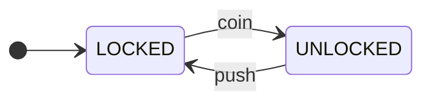
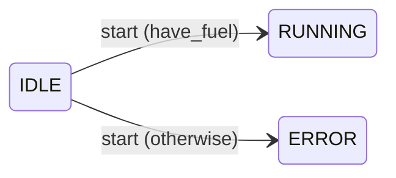

# fsm

A tiny state machine library in C. One header, one `.c` file, no dependencies,
no `malloc` — fine on a microcontroller.

## The idea, in one picture

Your thing is in one **state**. An **event** happens. It moves to another state.



A turnstile: locked until you pay, then it lets one person through.

You draw the arrows. This library runs them — you just type them out as a table:

| from | on event | go to | and run |
| --- | --- | --- | --- |
| `LOCKED` | `EV_COIN` | `UNLOCKED` | `take_coin` |
| `UNLOCKED` | `EV_PUSH` | `LOCKED` | `let_through` |

which in C is that same table, one row per arrow:

```c
static const struct fsm_transition table[] = {
	{ LOCKED,   EV_COIN, UNLOCKED, NULL, take_coin   },
	{ UNLOCKED, EV_PUSH, LOCKED,   NULL, let_through },
};
```

That is the whole library. Everything below is optional.

## Try it

```sh
make check    # run the tests
make run      # run the turnstile
```

## The whole program

```c
#include "fsm.h"
#include <stdio.h>

/* 1. Name your states and events. Any names you like. */
enum { LOCKED, UNLOCKED, N_STATES };
enum { EV_COIN, EV_PUSH };

/* 2. Say what should happen. ctx is your own data. */
static void take_coin(void *ctx)   { (*(int *)ctx)++; }
static void let_through(void *ctx) { (void)ctx; puts("clunk"); }

/* 3. Draw the arrows. */
static const struct fsm_transition table[] = {
	{ LOCKED,   EV_COIN, UNLOCKED, NULL, take_coin   },
	{ UNLOCKED, EV_PUSH, LOCKED,   NULL, let_through },
};

static const struct fsm_def def = { table, 2, NULL, 0 };

int main(void)
{
	int coins = 0;
	struct fsm m;

	fsm_init(&m, &def, LOCKED, &coins);   /* start in LOCKED */

	fsm_dispatch(&m, EV_PUSH);            /* locked - nothing happens */
	fsm_dispatch(&m, EV_COIN);            /* now UNLOCKED, coins == 1 */
	fsm_dispatch(&m, EV_PUSH);            /* prints "clunk", back to LOCKED */

	printf("coins=%d state=%d\n", coins, m.state);
	return 0;
}
```

## What one `fsm_dispatch` does

```
   fsm_dispatch(&m, EV_COIN)
             |
             v
   +--------------------------------------+
   |  walk the table from the top         |
   |                                      |
   |  from == my state, event == mine? ---+---> no: next row
   |  guard says yes?                  ---+---> no: next row
   +--------------------------------------+
             |  first row that fits wins
             v
   on_exit(LOCKED) -> take_coin() -> on_enter(UNLOCKED)
             |
             v
   m.state = UNLOCKED          returns FSM_OK
```

No row fits? Nothing runs, and you get `FSM_IGNORED`. That is normal, not an
error.

## The three calls

| call | what it does |
| --- | --- |
| `fsm_init(&m, &def, LOCKED, &my_data)` | set it up, start in `LOCKED` |
| `fsm_dispatch(&m, EV_COIN)` | feed it an event |
| `fsm_accepts(&m, EV_COIN)` | `1` if that event would do something |

Read the state with `m.state`. Never assign to it — send an event instead.

`fsm_dispatch` returns `FSM_OK` (it moved), `FSM_IGNORED` (no row fit) or
`FSM_EARG` (you passed something broken).

## A row, slot by slot

```
    { LOCKED,   EV_COIN,   UNLOCKED,   NULL,     take_coin }
        |          |           |         |            |
      from       event        to       guard       action
   which state   what       where    may veto      what to
    it applies  happened     to go   this row        run
       to
```

`guard` and `action` are optional — pass `NULL`. Two wildcards help:

| write | in slot | means |
| --- | --- | --- |
| `FSM_ANY` | `from` | any state — good for a reset or abort event |
| `FSM_SAME` | `to` | run the action, stay where you are |

## Two arrows, same event

Give both rows the same event and let a guard pick.



```c
{ IDLE, EV_START, RUNNING, have_fuel, NULL },   /* fuelled? go */
{ IDLE, EV_START, ERROR,   NULL,      beep },   /* otherwise, complain */
```

A guard that says no does not stop the search — it just falls through to the
next row. Rows are read top to bottom and the first fit wins.

## Doing something on arriving or leaving

Optional, one entry per state:

```c
static const struct fsm_state_ops states[N_STATES] = {
	[LOCKED]   = { light_red,   NULL },   /* { on_enter, on_exit } */
	[UNLOCKED] = { light_green, NULL },
};

static const struct fsm_def def = { table, 2, states, N_STATES };
```

They always run in this order:

```
   leaving LOCKED                    arriving in UNLOCKED
         |                                    |
     on_exit    ->     action     ->      on_enter
```

`fsm_init` runs the starting state's `on_enter` too. Don't need hooks? Pass
`NULL, 0` like the turnstile above.

## `ctx` — your own data

The `void *` you hand `fsm_init` is passed to every guard, action and hook.
Put a counter, a socket, a device handle in there. The library never looks
inside it.

## Files

```
include/fsm.h          the API, with comments
src/fsm.c              the implementation, ~130 lines
examples/turnstile.c   a bigger example, with guards and hooks
test/test_fsm.c        the tests
```

Written in Linux kernel C style: tabs, `struct` types (no typedefs),
kernel-doc comments, 80-column lines.

## Limits, so you are not surprised

- Flat machines only — no states inside states.
- No event queue and no timers. You call `fsm_dispatch` yourself, from your
  main loop or an interrupt.
- Rules are searched one by one. Fine up to a few dozen; sort and bisect if
  you ever have hundreds.
- One machine used from two threads needs your own lock. Separate machines
  sharing the same table are fine.
