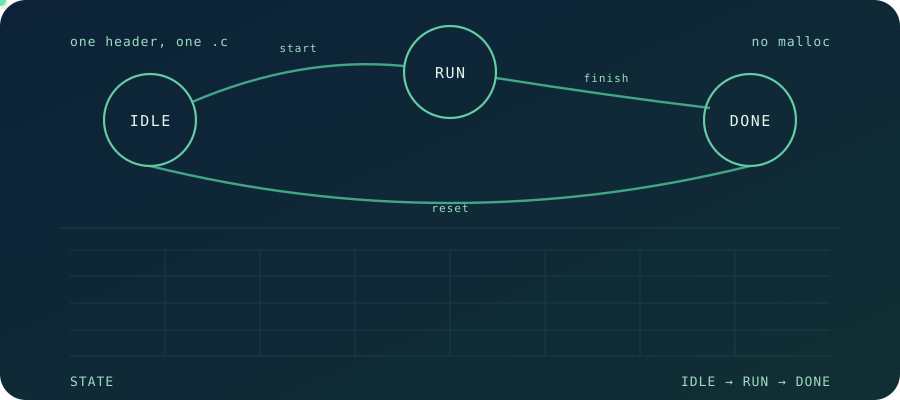

# algo-behavior

Choose what a robot does next with two small C99 libraries.

**Contents** · [Choose a library](#choose-a-library) · [Try the example](#try-the-example) · [Add it to your project](#add-it-to-your-project)

## Choose a library

| Library | What it does | Example and API |
| --- | --- | --- |
| [state-machine](state-machine/) | Describe modes such as locked and unlocked, and the events that switch between them. | [turnstile](state-machine/examples/turnstile.c) · [API](state-machine/include/fsm.h) |
| [behavior-tree](behavior-tree/) | Check conditions in priority order, such as checking the battery before continuing a patrol. | [patrol](behavior-tree/examples/patrol.c) · [API](behavior-tree/include/bt.h) |

[](state-machine/)

*[State machine example and API](state-machine/).*

## Try the example

From this repository’s root, use Make and a C99 compiler. No robot hardware is needed.

```sh
make -C state-machine run
```

The example models a turnstile. Watch how inserting a coin unlocks it and how pushing it changes the state. [Example source](state-machine/examples/turnstile.c)

## Add it to your project

For plain C, compile the source files in the library’s `src/` directory and add its `include/` directory to your compiler’s include path. For a CMake application named `app`, place this checkout inside your project and use the following lines.

```cmake
add_subdirectory(algo-behavior/state-machine)
target_link_libraries(app PRIVATE algo::state-machine)
```

For ESP-IDF, add the library directory to `EXTRA_COMPONENT_DIRS` and its name to the consuming component’s `REQUIRES`. Select either the individual libraries or the entire repository to avoid duplicate symbols.

<details>
<summary>Fetch just this library from GitHub with CMake</summary>

```cmake
include(FetchContent)
FetchContent_Declare(algo_state_machine
    GIT_REPOSITORY https://github.com/JonasAtelier/algo-behavior.git
    GIT_TAG        stable
    SOURCE_SUBDIR  state-machine)
FetchContent_MakeAvailable(algo_state_machine)
target_link_libraries(app PRIVATE algo::state-machine)
```

</details>

Run `make check` from the repository root to test the libraries. [MIT license](LICENSE)

[Browse the workshop catalog · Portable C libraries](https://github.com/JonasAtelier/jonas-atelier-libraries#portable-c-libraries)
